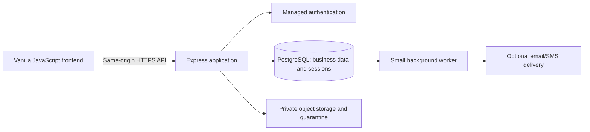

# PlazaHub backend design and migration proposal

Original proposal: prepared 3 November 2026 against checkpoint `bed22bc`. The direction was subsequently reviewed and approved for incremental local implementation; see [Stage 9 review](STAGE_9_REVIEW.md). Stage 10 provides a separate [local Express foundation](../server/README.md); Stage 11 adds [local PostgreSQL schema/migration tooling](STAGE_11_DATABASE.md). Authentication, runtime-role RLS, storage and business APIs remain future work. Provider purchases, budget and business-policy decisions remain review items; no cloud resource or production credential was created. The original proposed slices below are historical planning context; implementation status is recorded in the stage documents.

## 1. Recommendation and alternatives

Current continuation: [Stage 12A](STAGE_12_AUTH.md) adds the local session infrastructure. Live provider authentication remains disabled; Stage 12 acceptance gates are still open.

[Stage 12B](STAGE_12_ONBOARDING.md) adds the private invitation/account-linking foundation. Stage 13's local credential/isolation work can proceed independently while Stage 12's real-provider/delivery/recovery gates remain open; business APIs require both.

Keep HTML/CSS/vanilla JavaScript. Add one Node.js/Express API, PostgreSQL, managed authentication and private object storage. Supabase is the provisional managed provider for PostgreSQL/Auth/Storage; it is not a requirement or an approved purchase. Keep financial business operations behind the API.

This is my architectural recommendation for this codebase: JavaScript on the server supports the learning goal, SQL fits its related business records, and an explicit API makes authorization and transaction boundaries reviewable. Start as one application with feature modules. Microservices, React, Kubernetes, an accounting engine and payment-provider integrations are unnecessary for the first customer.

| Option | Benefit | Cost/trade-off for PlazaHub | Decision |
| --- | --- | --- | --- |
| Express + PostgreSQL + managed Auth/Storage | Retains JavaScript, explicit business services, SQL constraints; managed identity and file infrastructure. | API, session integration, database migrations and hosting still need maintenance. | Recommended proposal. |
| Browser directly using Supabase data APIs | Fewer custom HTTP endpoints. | Complex financial mutations still need transactional server/database functions; exposed tables/functions and policies require careful review. | Viable alternative, not the proposed first approach. |
| Django + PostgreSQL | Established authentication/permissions facilities and a structured backend. | Adds Python and rewrites of JavaScript domain behavior during frontend learning. | Prefer if FlexiSAF or a backend mentor requires Python. |

Django's authentication system is documented in its [official authentication guide](https://docs.djangoproject.com/en/5.2/topics/auth/). Supabase documents the distinction between [Data API grants, RLS and exposed schemas](https://supabase.com/docs/guides/api/securing-your-api); choosing it does not make business authorization automatic.

For a new backend, target a patched Node.js 26 LTS and Express 5, pin dependencies/lockfiles, and verify compatibility in the first local slice. Node's release table lists 26 as Active LTS from 28 October 2026. This proposal does not upgrade the installed runtime. See the [official release schedule](https://github.com/nodejs/Release) and [Express production guidance](https://expressjs.com/en/advanced/best-practice-security/).

Do not promise a free production tier or a hosting cost yet. Confirm budget, runtime/provider requirements, database region, backup needs, storage/egress, authentication email limits and expected usage before provisioning. Sample dashboard figures are not a capacity estimate.

## 2. Verified starting point

| Current file | What exists | Backend consequence |
| --- | --- | --- |
| [`js/navigation.js`](../js/navigation.js) | Role switcher; login/registration open demo dashboards. | Replace account/session behavior; displayed roles cannot authorize requests. |
| [`js/data/repository.js`](../js/data/repository.js) | Synchronous operations and joined profile/tenancy/unit views. Some older getters return live objects. | Keep the feature boundaries, but add asynchronous API reads, explicit commands and immutable response objects. |
| [`js/data/ledger.js`](../js/data/ledger.js) | Period invoices, approved allocations, pending/rejected evidence, in-memory receipts and kobo arithmetic. | Persist issued snapshots; enforce approval across concurrent requests. Never regenerate receipts at startup. |
| [`js/features/payments.js`](../js/features/payments.js) | Manual confirmation and evidence review; only an evidence filename is retained. | Actual evidence must be uploaded, authorized and reviewed independently of upload completion. |
| [`js/data/announcements.js`](../js/data/announcements.js) | Fixed recipient snapshots and read state. | Persist recipients and reads; real delivery is a separate operation. |
| [`js/data/rent-adjustments.js`](../js/data/rent-adjustments.js) | Future notices, explicit due-date application and stale-agreement checks. | Use the server's business date, durable term versions and approved notice policy. |
| [`js/data/documents.js`](../js/data/documents.js) | Metadata, visibility and withdrawal; no files. | Add private stored-object records and content authorization, not public URLs. |
| [`js/ui.js`](../js/ui.js) | HTML-string modal/toast rendering. | Audit every API-controlled value for text escaping; raw API error messages must not enter toast HTML. |

A fresh repository currently contains 12 tenant profiles, 49 units, 12 tenancies, 11 invoices, 10 payment rows and 8 demo receipts. Documents, announcements and rent notices start empty. Eight platform plazas are listed, but the operational fixtures are for plaza 1. One of the 10 payment rows is a legacy obligation marker, not money received.

These are synthetic fixtures, not production balances or imported business records. All browser edits reset on reload. The existing test suite checks demo consistency, not real authentication, database isolation or actual uploaded files. Browser layout/print QA remains paused.

## 3. Target boundary



Serve frontend assets and `/api` on one origin to simplify cookies and deployment. Only a dedicated public asset directory/allowlist is served; never expose the repository root, environment files, migrations or tests. The current loopback preview remains the demo server, not the production server.

The browser never receives database credentials, service-role keys, signing keys or payment-provider secrets. With Supabase, keep application tables in a nonexposed schema and deny direct browser access to them. Review/disable unused Data API exposure. Storage has its own controls; a database API setting does not secure every other product. This design follows the separation described in [Supabase API security](https://supabase.com/docs/guides/api/securing-your-api).

## 4. Identity, sessions and plaza isolation

An authenticated user is an account; a tenant profile is a person/business in a plaza. They are not the same record. Maintain user-to-plaza memberships and explicit user-to-tenant access links. A user may manage more than one plaza; a tenant profile may occupy several shops without receiving several logins.

Proposed session flow: the API integrates the provider's supported login/recovery/invitation flows, verifies identity, and creates an opaque application session. Use maintained session middleware with a persistent PostgreSQL store. The browser gets a Secure, HttpOnly, SameSite cookie; provider refresh credentials stay server-side with appropriate encryption and rotation. Use request/session-scoped auth clients; never share a mutable logged-in provider client between users. Do not build password hashing, JWT verification or recovery tokens from scratch. This is our proposed server-only integration, not a claim that the provider's browser/SSR quickstart already implements it. Prove refresh, logout, revocation and parallel requests in an authentication spike before real users.

Express documents that its default session MemoryStore is unsuitable for production; see [session middleware](https://expressjs.com/en/resources/middleware/session/). Supabase's [`getUser`](https://supabase.com/docs/reference/javascript/auth-getuser) contacts its authentication server for user verification. Its [advanced guide](https://supabase.com/docs/guides/auth/server-side/advanced-guide) distinguishes signature verification from checking a revoked session. Do not trust a decoded browser token or cached role alone.

Every protected request must validate session expiry/revocation, account status, plaza status, active membership and resource ownership. Membership changes take effect from the database, not a role claimed in a request. Rotate sessions after authentication/privilege changes; expire/revoke them on logout or suspension. Define idle/absolute timeouts and recovery behavior during the spike. Protect login and recovery from abuse and require MFA for privileged production accounts.

For cookie-authenticated writes, validate request origin and use a session-bound CSRF defense; SameSite alone is insufficient. Rate-limit authentication/uploads and validate request schemas and sizes. See [Express security guidance](https://expressjs.com/en/advanced/best-practice-security/) and [OWASP CSRF guidance](https://cheatsheetseries.owasp.org/cheatsheets/Cross-Site_Request_Forgery_Prevention_Cheat_Sheet.html).

| Operation | Owner/manager in that plaza | Linked tenant account | Platform administrator |
| --- | --- | --- | --- |
| Shops, assignments, invoice issuance | Manage within plaza | Own permitted agreement/bill views | No routine operational access |
| Evidence and payment review | Review authorized submissions | Submit/view own evidence; cannot approve | No routine access |
| Receipts | View plaza records | View own confirmed records | No routine access |
| Announcements/rent notices | Publish/manage within plaza | Addressed notices and own read status | No routine access |
| Documents | Manage permitted plaza records | Current permitted metadata/content only | No routine access |
| Plaza account suspension/plans | Own permitted account information | None | Explicit platform capabilities |

Default-deny missing or suspended membership. Proposed suspension behavior blocks operational API access without deleting history; confirm customer access/export obligations before launch. A former occupant can retain specifically authorized historical records only while their account/access link permits it. Tenant profile archiving does not by itself decide login revocation.

Every operational row carries `plaza_id`; queries and foreign keys preserve it. A guessed UUID is not authorization. Add RLS as a second boundary and test using the actual application DB role: neither table ownership nor `BYPASSRLS` is acceptable for ordinary requests. Set verified user/plaza context transaction-locally on the acquired connection and clear it by ending the transaction; absent context denies access. Platform administrative actions use separate restricted paths/capabilities. PostgreSQL explains the bypass caveats in [row security](https://www.postgresql.org/docs/current/ddl-rowsecurity.html).

## 5. Proposed data model and invariants

This is a logical schema, not a migration already applied. Use durable UUID record IDs; keep readable invoice/receipt numbers separate. Preserve name/shop snapshots on issued records.

| Record group | Responsibilities |
| --- | --- |
| Users, sessions, plaza memberships, tenant access links | Verified provider identity, session lifecycle and current capabilities. No plaintext passwords. |
| Plazas, units, tenant profiles | Plaza configuration; shop identities; separate business/contact profiles. |
| Tenancies, tenancy term versions | Tenant/unit/plaza relationship, occupancy lifecycle, rent and dates, documented corrections/closure. |
| Invoices, invoice items | Immutable issued periods, due dates, charges and display snapshots. |
| Payment records, allocations | Evidence/manual source, review lifecycle and immutable approved allocations. |
| Receipts | One durable snapshot per confirmed allocation; stable number and balance after that allocation. |
| Announcements, recipients, reads | Original recipient set; separate read events, not delivery proof. |
| Rent notices, notice read/status events | Old/new terms, policy version, effective/application dates and cancellation history. |
| Document metadata, stored objects, visibility events | Tenancy/plaza scope, sharing/withdrawal, immutable file versions and validation state. Evidence can reference a private stored object without becoming a tenancy document. |
| Maintenance requests/updates | Assigned tenancy, request text, status and management history. |
| Audit events, idempotency records, outbox | Actor/resource/action records, safe request retries and committed delivery jobs. |

Use integer kobo in PostgreSQL `bigint`, positive amount constraints and explicit currency `NGN`. Return large integer values as decimal strings in JSON; convert through a bounded adapter instead of unsafe JavaScript integer coercion. Store event timestamps as UTC `timestamptz`, billing periods as `date`, and derive business dates using `Africa/Lagos` on the server.

Implement database rules for unique shop numbers within a plaza; same-plaza composite foreign keys; positive invoice/payment amounts; valid date ranges; one active assignment per unit via a partial unique index; one receipt/allocation per payment in this MVP; and one open rent notice per tenancy. Protect invoice-period overlap using a suitable range/exclusion constraint, with required extension support checked on the chosen provider. SQL constraints do not replace request authorization. PostgreSQL documents these mechanisms in [constraints](https://www.postgresql.org/docs/current/ddl-constraints.html).

Do not cascade-delete financial/history records when closing a tenancy or archiving a profile. Restrict updates to issued financial fields; allow only explicit state transitions and append audit events. An ordinary row CHECK cannot validate a sum across all allocation rows: the approval service must enforce that invariant transactionally.

### Payment confirmation: the critical transaction

Proposed approval algorithm:

1. Validate reviewer capability, invoice/plaza scope and the request's idempotency key.
2. Begin a transaction. Acquire the invoice row lock, then the payment row lock in a consistent order. Recheck scope/state after locking.
3. Return the existing result for the same already-completed decision. Reject a conflicting decision/key payload.
4. Recalculate outstanding from issued charges minus approved allocations. Reject an amount above it. Pending/rejected evidence subtracts nothing.
5. Insert the allocation and unique receipt snapshot/number; update payment state; append the audit event, idempotency result and any outbox entry.
6. Commit everything, or roll it all back. Send no notification before commit.

Manual confirmation must use the same invoice-lock/remaining-balance path. Every allocation writer follows that path; a process-local mutex is insufficient. See PostgreSQL [row locks](https://www.postgresql.org/docs/current/explicit-locking.html). Use a single acquired `pg` client throughout the transaction, as required by [node-postgres transactions](https://node-postgres.com/features/transactions), with bounded retries for transient conflicts. All SQL values are parameterized; see [query parameters](https://node-postgres.com/features/queries).

An example acceptance test submits two concurrent ₦70,000 approvals against ₦100,000 outstanding. Exactly one succeeds; the second conflicts and remains unallocated. Repeating the successful request returns the original receipt, even after an interrupted network response. Persist idempotency by actor/plaza/operation/key and request hash in the same transaction.

Use database-backed number allocation, never `MAX(id)+1`. Receipt numbers survive restarts; gaps are allowed in this proposal unless a reviewed business requirement says otherwise. Do not import `DEMO-*` numbers as official records. Prevent silent edits to approved payments; design audited correction/credit/refund workflows before enabling them.

### Notices and occupancy

Keep the existing distinction between occupancy closure and lease expiry. Lock the unit/assignment when assigning or closing a tenancy. Preserve the current MVP's single-invoice allocation and no-overpayment rules until a reviewed allocation/credit policy exists.

Resolve announcement recipients once at publication, in the same transaction as publication/audit. Do not dynamically add replacement occupants. Rent-notice application locks and checks the current term version, server effective date and approved policy; no browser date or client-entered minimum establishes production eligibility. Keep original and applied terms as separate history. Future billing and mid-period rate changes need explicit proration/correction rules; existing invoices remain intact.

## 6. Documents and evidence

Preserve Stage 8's explicit scopes: tenancy documents follow the saved tenant/agreement; general plaza information follows current membership. Re-evaluate authorization for content as well as metadata, including after withdrawal. Do not turn the example filename into a storage key or download URL.

Proposed upload path: authorize the request and intended resource; allocate a server-generated object ID/key; enforce allowed types/size; upload into private quarantine; inspect actual content/signatures and scan it; record a validated immutable version before allowing access. Fail closed when validation/scanning is unavailable. Clean abandoned uploads. An uploaded proof remains pending evidence until a reviewer confirms payment. Follow the [OWASP upload guidance](https://cheatsheetseries.owasp.org/cheatsheets/File_Upload_Cheat_Sheet.html); frontend extension checks are insufficient.

Private Supabase buckets support authorized downloads and time-limited signed URLs; public buckets expose retrieval to anyone with the URL. See [bucket access models](https://supabase.com/docs/guides/storage/buckets/fundamentals). For the initial sensitive-file path, prefer an API download that rechecks access and streams the object as an attachment. If signed URLs are introduced, make their lifetime short and document that withdrawal cannot retract a URL already issued before expiry, or content already downloaded. Storage service credentials bypass policies and remain server-only; see [Storage access control](https://supabase.com/docs/guides/storage/security/access-control).

Return private responses with appropriate no-store caching; avoid executing uploaded HTML/SVG or exposing raw object URLs in logs. Restrict size/type/retention based on the actual evidence/document requirement, not an invented universal limit. Metadata visibility history is not a complete production audit trail by itself.

## 7. API and frontend migration

Proposed API surface (not existing routes):

| Route group | Examples / responsibility |
| --- | --- |
| Session | `POST /api/session/login`, `GET /api/session`, `DELETE /api/session`; supported invitation/recovery endpoints. |
| Plaza resources | `/api/plazas/:plazaId/units`, `/tenants`, `/tenancies`; every requested plaza must be authorized. |
| Bills and review | `/invoices`, `/payment-submissions`, `/payments/:id/approve`, `/payments/:id/reject`, `/receipts/:id`. Tenant submissions cannot set an approved status. |
| Communication | `/announcements`, `/announcements/:id/read`, `/rent-notices`, `/rent-notices/:id/apply`. |
| Files | `/documents`, `/uploads`, `/documents/:id/content`; separate authorization for evidence. |
| Operations | `/maintenance`, `/reports`; scoped server-generated summaries/exports, not a download of all platform data. |

Except the session routes, the resource examples are relative to `/api/plazas/:plazaId`. Use `/me` or session-derived tenant links for tenant views; ignore/reject spoofed ownership fields. Return structured errors with a stable code, safe message, field errors and request ID. Distinguish unauthenticated, forbidden/not-found, validation, stale/conflicting and transient failures. Paginate/filter on the server and project only fields the caller can see.

The current renderers expect arrays immediately. An API adapter alone cannot preserve that behavior. Add a small `api-client.js` for fetch/session/error handling, an `api-repository.js` that maps agreed response shapes, and migrate one feature at a time to loading/error/empty/success states. Disable duplicate submits while pending; retain drafts on failure. Cancel/ignore stale search responses and scope page caches by user/plaza. Prefer joined page responses over one network request per `getTenant`/`getUnit` inside loops.

Retain a clearly separate demo repository and its tests. Never fall back to mock success or local writes when a live API request fails, and do not mix demo and live sources within a payment workflow. The live app gets identity/plaza/tenant links from `/api/session`; remove `DEMO_TENANT_ID`, default plaza 1 and the role switcher from its data path. The demo role switcher can remain on the separate prototype.

Before real API data, audit all HTML-string renderers (including older dashboards and toasts), use text insertion/escaping, and migrate inline handlers as part of a tested content-security-policy rollout. Handle expired sessions, slow mobile connections and retries without losing form state or displaying another plaza's cached page.

## 8. Proposed folders: create only when the slice needs them

```text
server/
  app.js                 HTTP setup, public assets, middleware and errors
  db.js                  Connection pool and transaction helper
  auth.js                Provider/session integration and membership checks
  features/              Small route/service/query modules by workflow
  migrations/            Ordered SQL schema changes
  tests/                 Actual PostgreSQL and HTTP integration tests
js/data/
  api-client.js          Browser transport and safe error handling
  api-repository.js      Async operations / response mapping
  repository.js          Current demo composition, retained during migration
```

No folder above has been created in this stage. Start without an ORM so the initial SQL constraints and transactions are visible; reconsider if query/migration maintenance justifies one. `express`, `pg`, a maintained session/store package and the chosen provider SDK each have a clear purpose; none is installed now. Use a separate locked backend dependency boundary so the buildless demo stays runnable.

## 9. Incremental migration and acceptance gates

| Slice | Concrete scope | Required evidence before moving on |
| --- | --- | --- |
| B1: local foundation | Separate local API health endpoint; isolated PostgreSQL schema/migrations and synthetic fixtures for plazas, identities/memberships, shops and tenancies. Protected routes deny access until auth is configured. | Repeatable setup/reset on a disposable DB; same-plaza FKs; concurrent double-assignment rejected; demo entry/tests unaffected. |
| B2: identity and scoped reads | Provider/session spike, invitation/account linking, read-only shop directory through the async adapter. | Expired/revoked sessions and CSRF tested; tenant/plaza impersonation fails; DB-role/RLS isolation tested with two plazas and two tenant accounts. |
| B3: operational writes | Tenant profiles, assignment/closure, maintenance and term history. | Concurrency, stale writes, archive/history and API failure states tested; changes survive restarts. |
| B4: financial workflows | Invoice issuance, real evidence intake, approval/rejection, allocations and durable receipts. | Concurrent/retried approvals and rollback tests pass; no pending receipt; balances reconcile; correction policy reviewed. |
| B5: communication | Persistent recipient/read snapshots and versioned rent notices; optional outbox worker. | No recipient leakage; failed delivery is retryable without duplicate publication; server-date/stale-term application tests. No real sends until configured and explicitly authorized. |
| B6: documents | Actual validated private objects, permissioned content access and withdrawal. | Private/other-tenant/other-plaza downloads denied; quarantine failures, withdrawal and object cleanup tested. |
| B7: staging/pilot | Selected hosting, restore drill, monitoring and realistic customer walkthrough. | Responsive/keyboard/print QA resumed by agreement; recovery targets met; customer sign-off on account, billing and notice policies. |

Keep commits/checkpoints for each slice. There is no reliable time estimate yet: provider constraints, mentoring availability and pilot rules affect scope. Do not import the sample balances or treat current browser state as a migration source. Real onboarding needs reviewed source records, mapping/reconciliation, explicit opening balances and a repeatable import audit.

## 10. Deployment, delivery, audit and recovery

Use separate development, staging and production resources/secrets. Select an HTTPS Node-capable host and managed database region together, then measure access from Nigerian mobile connections. No provider/region has been selected or paid for. Bound connection pools to the hosting limits and review database migrations before release; do not auto-run destructive changes on every request.

Write audit events in the mutation transaction with actor, plaza, action, resource, timestamp and relevant before/after values. The ordinary application role may append but cannot edit/delete them; this is not a claim that a database owner can never tamper with history. Log request IDs and safe error context, excluding passwords, tokens, file contents, full bank details and signed URLs. Monitor authorization failures, job retries, upload failures, approval conflicts and service/database health.

Use a transactional outbox for email/SMS jobs only when introduced. Publication/read/delivery are distinct states. Retry jobs with deduplication keys and backoff; a provider outage must not roll back confirmed money or mark a message delivered. Begin with a scheduled worker in the same codebase; a separate queue platform is optional later.

Back up both PostgreSQL and file objects, secure the copies, define retention, and actually restore them into an isolated environment. Supabase explicitly says its database backups do not include Storage objects; see [database backups](https://supabase.com/docs/guides/platform/backups). Confirm plan-specific backup/recovery capabilities before buying. Agree maximum tolerable data loss and recovery time with the pilot customer; no numerical recovery guarantee is assumed here. Test application versions against restored schema/object references, not just a successful backup job.

Prefer forward-compatible migrations and a rehearsed application rollback. A bad release must not invite deleting approved allocations or resetting customer data. Keep correction and recovery actions authorized/audited.

## 11. Decisions required before dependent implementation

1. Does FlexiSAF require a backend language/provider? What budget, hosting access and mentoring are available? The stack above remains provisional until reviewed.
2. How are owner/manager accounts verified, tenants invited and business profiles linked to logins? Can one business have multiple authorized staff? What happens to historical access on departure/suspension?
3. What billing periods, advance billing, partial-payment/overpayment, bank-reference correction and receipt-number rules will the first plaza actually use? Who can confirm money, and how is self-approval prevented? Proposed default: prohibit a reviewer approving their own linked tenant's payment.
4. What are the reviewed rent-change/notice and lease-renewal rules? Mid-period changes and already-issued bills need a correction policy; a client-entered demo minimum is insufficient.
5. Which documents/evidence types, size limits, access audiences, retention and deletion policies are required? Confirm privacy, location and customer obligations before choosing storage regions and historical-access defaults.
6. What suspension/export, backup recovery and operational-support commitments can be promised? Automated integrations and subscription billing remain outside the initial pilot until separately designed.

These are implementation gates, not reasons to rewrite the frontend or to assume answers. The next proposed implementation is B1, a local-only API/database proof of concept after this design is reviewed. Provider provisioning, real accounts, sensitive uploads, actual message delivery and deployment require concrete follow-on scope.

## 12. Verification and learning checkpoint

At Stage 9 completion, the work had inspected the real source, queried the fresh demo inventory and checked official documentation. No API, SQL migration, security policy, upload system or backend deployment had been executed then. Stage 10's local HTTP foundation is documented separately. Existing browser tests do not establish the proposed security guarantees. Validate this design with real PostgreSQL/HTTP concurrency and authorization tests when each slice exists; retain the existing demo regression suite alongside them.

Learning exercise: trace `reviewPayment` in the current ledger, then walk through the proposed transaction above with two managers clicking Approve at once. Explain why checking a balance in JavaScript before a later database write is insufficient, and why the receipt and allocation must commit together.
